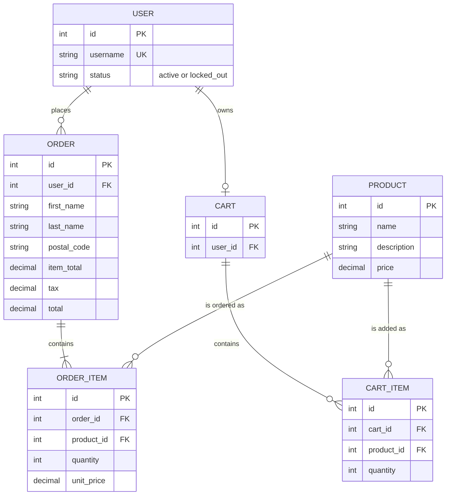
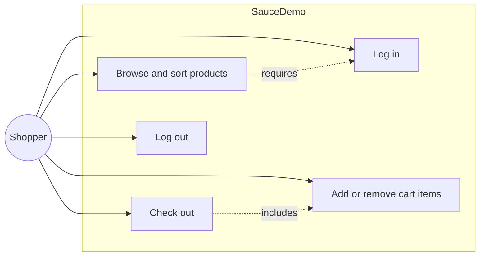
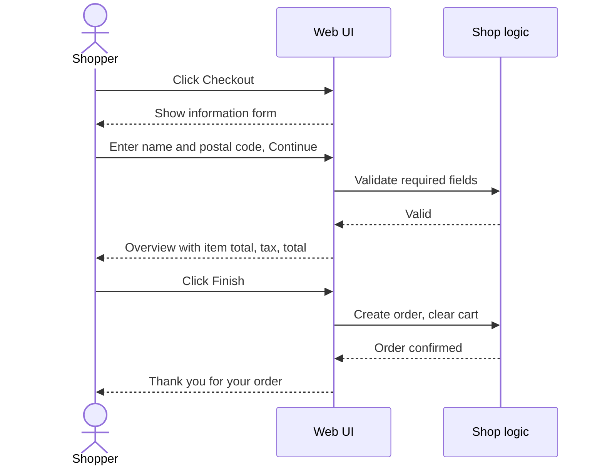
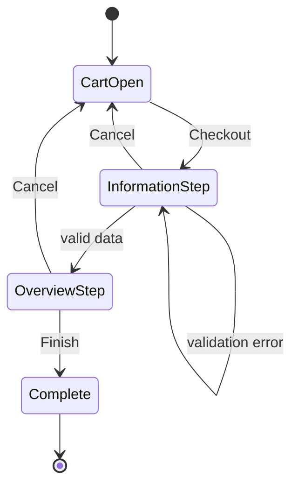
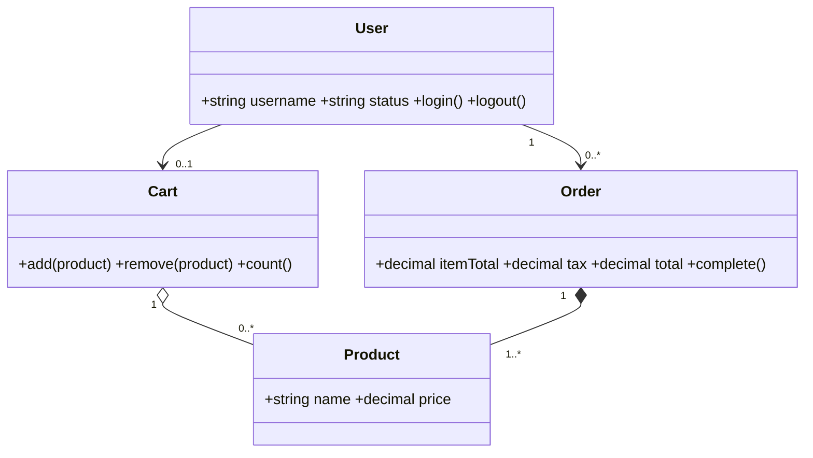

# ERD and UML: domain model of the SauceDemo shop

SauceDemo (saucedemo.com) is a public demo shop with no visible database. This is a **domain model I derived from its observable behaviour** (login, product list, cart, checkout), written the way I would document a system under test.

## 1. ERD

## 2. Use case (UML)

## 3. Sequence diagram (UML): checkout

## 4. State diagram (UML): checkout

## 5. Class diagram (UML)

